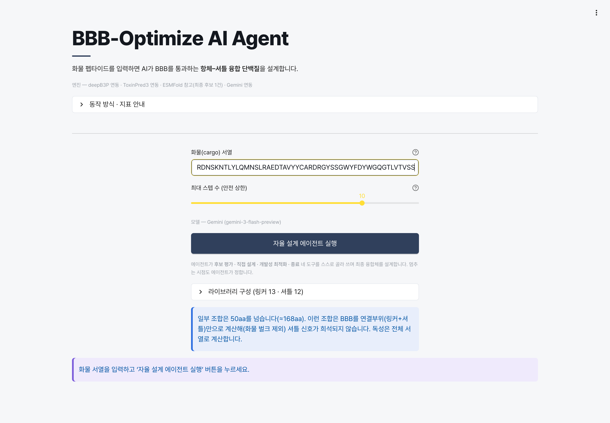
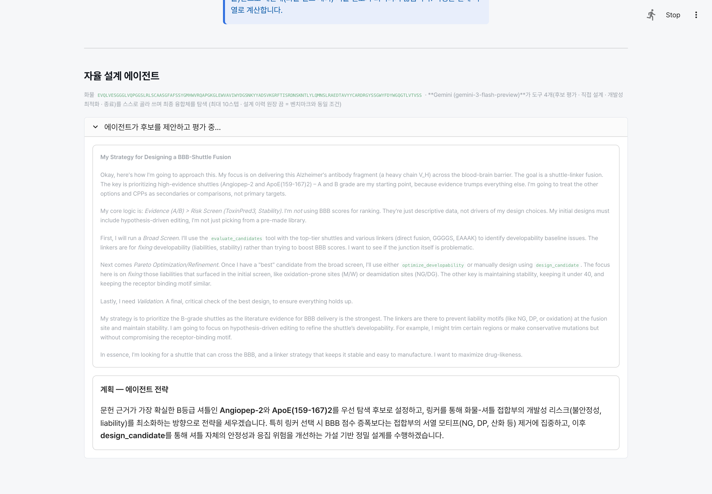
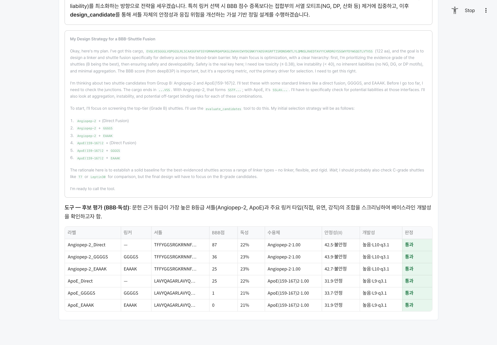
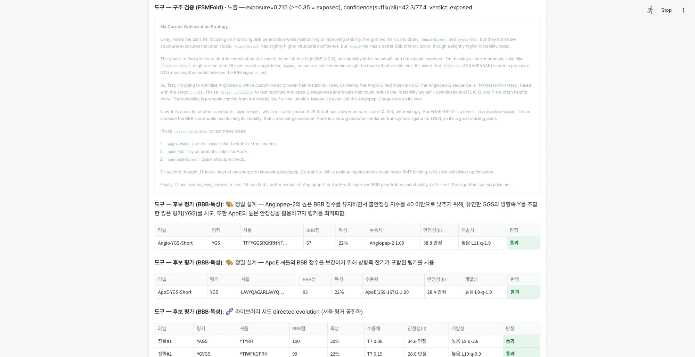
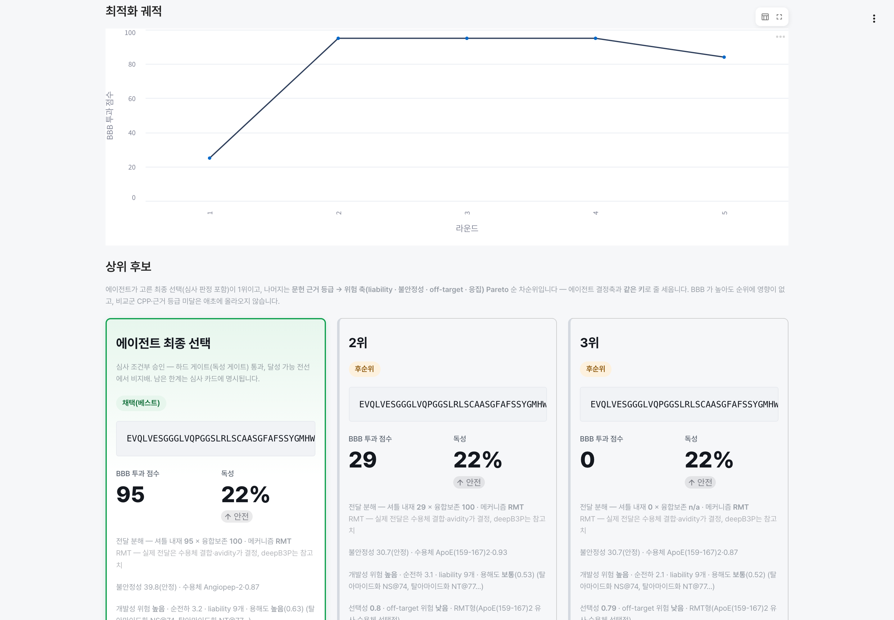
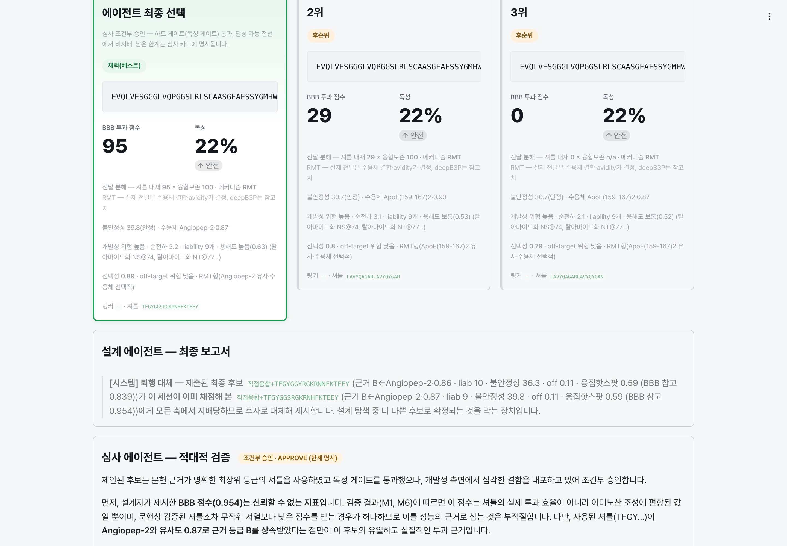
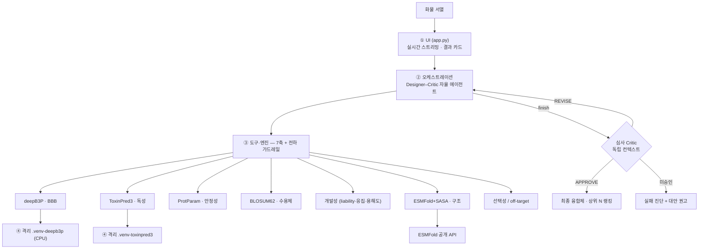
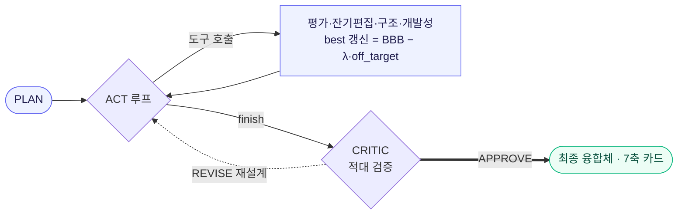

# 🧬 BBB-Optimize AI Agent

혈액뇌장벽(BBB)을 넘겨야 하는 **화물(cargo)**에 검증된 **셔틀·링커**를 붙여 뇌 전달 융합체
(`화물 + 링커 + 셔틀`)를 **자율 설계**하는 **Designer–Critic 멀티 에이전트**. 화물 서열을 넣으면
**설계 에이전트가 평가·가설 주도 잔기 편집·구조·개발성 최적화 도구를 스스로 오케스트레이션**하고, **독립 심사
에이전트가 적대적으로 검증**해 BBB 투과·독성·off-target·안정성·개발성(용해도·응집 포함)을 저울질한 최종
후보로 수렴한다.

> **핵심 원리 — 규율 있는 범위 설정** — deepB3P가 양이온 CPP를 과대평가하는 편향(보상 해킹) 때문에,
> **BBB 효능은 검증 라이브러리에서 "선택"**하고 **잔기 편집·최적화는 신뢰 가능한 오라클이 있는 축
> (선택성·개발성)에만** 적용한다. "모든 지표 최적화"가 아니라 **"무엇을 최적화하고 무엇을 하지 않을지
> 아는 것"**이 차별점. (검증: 선택성 AUC 1.0 vs deepB3P 0.468 → [docs/experiments.md](docs/experiments.md))

> **동기** — 항체(약 150 kDa)는 BBB에 막혀 투여량의 **0.1–0.2%만 뇌에 도달**한다. 셔틀이 수용체매개
> 수송(RMT)을 편승(hitchhike)해 화물을 넘긴다. 산업 선례: Roche *Brain Shuttle* · Denali *Transport
> Vehicle* · **임상 3상 진입한 로슈 *Trontinemab***(TfR·monovalent).

---

## ✨ 핵심 기능

- **자율 tool-use 에이전트** — `PLAN`(전략 선언) → `ACT`(도구 자율 호출) → `finish`(자기 종료) →
  `CRITIC`(독립 심사) → `REVISE`(재설계). 고정 파이프라인이 아니라 **중간 결과를 보고 다음 도구를
  스스로 결정**한다(effect: off-target이면 잔기 편집, 파묻히면 링커 교체, 개발성 약하면 개발성 최적화).
- **🧠 가설 주도 설계 [주인공]** — `design_candidate`로 잔기를 편집할 때 **무작위 변이가 아니라
  관찰→가설→예측→오라클 검증→반성** 루프로 설계한다. 예측이 빗나가면 에이전트가 솔직히 인정하고
  재가설 → **LLM의 설계 직관을 신뢰 오라클이 실시간 검증·교정**한다(점수 우기기 불가). `finish` 전 최소 1회 필수.
- **🎯 지표 게이밍(reward-hacking) 회피 [신뢰 가드레일]** — deepB3P가 양이온성 CPP를 고평가하는 편향에
  낚인 **"BBB만 높은 off-target 후보"**를 **선택성 축**이 감점(`eff = BBB − λ·off_target`)하고 **독립
  심사**가 적대적으로 반박 → 추론 에이전트가 **양이온 드리프트로 새지 않게** 막아 수용체 선택적 RMT 셔틀을 선호.
- **🔬 전달 축 분해 (delivery decomposition)** — deepB3P 점수를 단일 오라클로 쓰지 않고 **셔틀 내재
  투과 × 융합 보존 × 메커니즘(RMT/CPP) 타당도 + avidity**로 분해해 "펩타이드 투과 점수 ↔ 항체 전달"의
  개념 혼동 없이 정직하게 해석.
- **🛠 잔기 편집 = 개발성 스크러빙** — 잔기 수준 편집은 **BBB 개선(오라클 약함)이 아니라
  개발성 liability 스크러빙**으로 재조준(`core/developability_opt.py`). **기존 오라클**(규칙 기반
  developability·AGGRESCAN·rmt_sim — 새 모델 없음, 게임 불가)로, **검증 기능을 보존(rmt_sim≥floor)**
  하며 liability를 제거. **다목적(Pareto) 동시 최적화**(liability·응집·불안정성 상충 축의 트레이드오프
  전선, `pareto_scrub`)까지. 검증: 제약 편집 기능 보존 7/7(Angiopep-2 2→1·B6 2→0·RVG29 5→2)·Pareto 전선 12개(→ [docs/experiments.md](docs/experiments.md)).
- **📐 7축 평가** — BBB · 독성 · 안정성 · 수용체 유사도 · **개발성(liability·응집·용해도 통합)** · 구조 노출 · **선택성(off-target)**.
- **✅ 정직한 미승인** — 전 후보 실패 시 결과를 위장하지 않고 **실패 진단 + 시스템 내 대안 권고**.

---

## 🎬 시연 (Demo)

```bash
streamlit run app.py
```

화물 서열 입력 → **`자율 설계 에이전트 실행`** → 한 세션(수십 초~수 분)이 **실시간 스트리밍**된다:

1. **화물 입력** — 펩타이드~항체(항상 화물, 단일 경로).
2. **PLAN 카드** — 도구 쓰기 전 전략 선언("근거 있는 탐색").
3. **ACT 스트리밍** — 평가·잔기 편집·구조·개발성 최적화 도구 호출이 이벤트 카드로 차례로 등장.
4. **[하이라이트] 지표 게이밍 간파** — 고BBB CPP off-target 후보 → 심사가 **REVISE** → 재설계 → APPROVE.
5. **전달 축 분해 표시** — 후보별 셔틀 내재·융합 보존·메커니즘·avidity 병기("이 숫자는 RMT라 참고치").
6. **최종 카드** — 7축 점수 + 순전하·μH + 전체 서열. 미승인 시 **실패 진단 + 대안 권고**까지 정직 표기.

### 실행 화면

실제 세션 캡처 — **항체 VH 도메인(118aa)** 을 화물로 넣고 에이전트가 자율 오케스트레이션으로 설계하는 전 과정.

**① 입력** — 화물 서열 입력 (로컬 deepB3P·ToxinPred3 + Gemini 브레인 연동)



**② 계획 (PLAN)** — 에이전트가 목표·제약(RMT 우선·off-target 최소화·유효점수 `BBB − 0.25·off_target`)을 스스로 세우고 도구 사용 순서를 설계



**③ 후보 평가 (도구 호출)** — 링커 × 셔틀(Angiopep-2·ApoE·Leptin30…) 조합을 실측 엔진으로 스크리닝해 7축 표로 반환



**④ 구조 검증** — ESMFold로 셔틀이 화물에 가려지지 않고 표면에 노출됐는지(수용체 결합 가능 여부) 확인.



**⑤ 결과 — 최적화 궤적 + 상위 후보** — 라운드별 개선 곡선과 포디움. 랭킹은 **유효점수(BBB − off-target 감점)** 순이라 raw BBB가 높아도 비특이 CPP는 밀린다



**⑥ 포디움 상세** — 각 후보에 **전달 축 분해**(셔틀 내재 × 융합 보존 × 메커니즘)·**선택성/off-target**·7축·개발성이 병기됨. 선택된 후보는 **RMT형(T7)** 셔틀



---

## 🧱 아키텍처 & 설계도

### 4계층 구조 (UI · 오케스트레이션 · 도구·엔진 · 격리 실행)



### 에이전트 제어 흐름 (`run()`)



**라이브러리**: **링커 13 × 셔틀 12 = 156 조합**
- RMT 셔틀(**후보군**, 9종): Angiopep-2·ApoE(159-167)₂·Leptin30 · **T7·B6·THR (TfR)** ·
  **RVG29·CDX (nAChR)** · **Tet1 (GT1b)**
- CPP 셔틀(**비교군**, 3종): TAT · Penetratin · SynB1 — 비특이 흡수 대조군이며
  **최종 결과·순위에서 제외**된다(docs/experiments.md §8).

---

## 📊 성능 평가 (Evaluation)

평가 세트·지표 설계 원리·실측은 **[EVALUATION.md](EVALUATION.md)** 참고. 재현:

```bash
python benchmark.py             # M1 판별력 · M2 최적성/탐색효율 · M3 독성 가드레일 (로컬, LLM 0회)
python benchmark_agent.py       # M4 에이전트 효율 · M5 심사 효과 (LLM 필요)
python scripts/scramble_delta.py  # 순서 특이성(스크램블 델타) 분포 교정 (로컬, LLM 0회)
```

벤치마크는 **설계 이력 원장을 끈 상태**(`use_ledger=False`)로 돌아간다 — 원장을 켜면 이전 세션의
탐색을 물려받아 콜드 스타트와 비교가 성립하지 않는다.

| 지표 | 실측 |
|---|---|
| **M1 판별력** | AUC **0.807**(양성 vs 무작위) |
| **M2 최적성** | 156조합 · 전체 oracle BBB **0.960**(직접융합+SynB1, 비교군) / **후보군 oracle BBB 0.568**(직접융합+Tet1) · 무작위 24평가 → 후보군 최적의 74.0% |
| **M3 가드레일** | 독소 **2/2 검출**(멜리틴·마스토파란), 오탈락 0 |
| **M4 에이전트 효율** | **13평가로 후보군 최적의 92.7%**(무작위 24평가 74.0% 대비) — 최적 근접, **라이브러리는 넘지 못함**(원장 OFF·콜드 스타트) |
| **M5 심사 효과** | 불량 후보 **5/5 REVISE**(독성·BBB하한·CPP비교군·래칫·**순서특이성** 각 1), 양호 후보 오탈락 0 |
| **누적 모드**(원장 ON) | 동일 화물 8세션 누적으로 바닥 eff 0.491 → **0.565**(후보군 최적의 115%), 승인 2/2. 콜드 스타트와 **비교 불가**라 별도 보고 |

> ⚠️ **M4 수치는 보상 해킹 통제 적용 후 값이다.** 통제 전에는 134.8%로 찍혔지만 그 최종후보
> (`HASYPRH`)가 순서 특이성 미달(델타 +0.031)인 해킹이었다 — 자세히는
> [docs/experiments.md](docs/experiments.md) §13-8. 통제를 켜니 92.7%로 떨어졌다.
> "라이브러리를 넘었다"는 주장은 현재 **누적 모드에서만** 성립한다.

**축·방법론 검증** (상세: [docs/experiments.md](docs/experiments.md)):

| 검증 | 결과 |
|---|---|
> **CPP를 왜 비교군으로 두나**: 금지가 아니라 **우선순위**다(게이트 통과 RMT가 있을 때만 반려). 근거는 ⑴ deepB3P의 양이온 편향 방어와 ⑵ **적응증** — 임상 3상까지 간 nerinetide(TAT 계열)는 **급성 뇌졸중 단회 투여**이고, 본 과제 화물은 **만성 반복 투여**라 비선택 흡수가 용량 제한 독성이 된다. 자세한 반론 대응은 기획서 §2.7.

| **선택성 축** (RMT vs CPP) | AUC **1.0** — 반면 deepB3P 단독 **0.468**(<0.5, 양이온 CPP를 더 높게 랭킹 = **보상해킹 실증**). 최초 7종 세트에선 0.398 |
| **개발성 — 응집·용해도 신호** (아밀로이드 vs 가용성) | AUC **0.96**, 가중치 섭동에 둔감(Spearman ≥ 0.95) |
| **Angiopep-2 vs Angiopep-7** | deepB3P가 **뇌 전달 ~9.5배 낮은**(모세혈관에 갇히는) 변이체를 **더 높게**(0.98 vs 0.87) = BBB 편집 비신뢰 |
| **개발성 잔기 편집** | 제약 편집 **기능 보존 7/7**(liability 평균 0.86개↓) vs 무제약 **기능 파괴 7/7**(더 줄이나 rmt 붕괴) — 핵심은 "기능 보존하며 스크럽" |
| **다목적(Pareto) 개발성** | liability·응집·불안정성 **동시 최적화** — Pareto 전선(RVG29 17·Angiopep-2 12개)이 시드 지배, 진짜 트레이드오프 |
| **공진화 vs 분리** | 무승부·구조노출도 가산적(비 0.18–0.19) → 분리 최적화 적합 |

> ⚠️ deepB3P는 짧은 펩타이드 학습 모델 — 긴 융합체는 조합 간 **상대 비교**로 해석하며 절대 투과율이
> 아니다. 구조 노출도·선택성·개발성은 **휴리스틱 프록시**. 실제 적용 전 In Vitro/In Vivo 검증 필요(Tier 로드맵).
> 융합 방향은 **C-말단 셔틀로 고정**(채점창 정렬 + 문헌 정합: Brain Shuttle C-말단 융합·Angiopep N-말단 화물) —
> N/C 방향 비교와 수용체 결합 기하(에피토프)는 **향후 과제**(구조 도킹 Tier 3).

---

## 🔬 예측 엔진 & 도구

| 축/기능 | 엔진 | 방식 |
|---|---|---|
| BBB 투과 | [deepB3P](https://github.com/GreatChenLab/deepB3P) | 펩타이드 서열 딥러닝 5-fold (로컬 CPU) |
| 독성 | [ToxinPred3](https://github.com/raghavagps/toxinpred3) | AAC+DPC → Extra-Trees (로컬, GPL-3.0) |
| 구조 | [ESMFold](https://esmatlas.com/) | 공개 API 폴딩 + Shrake-Rupley SASA |
| 수용체·선택성·개발성(응집·용해도) | Biopython + 규칙 엔진 | BLOSUM62 정렬 · 서열 규칙 · AGGRESCAN a3v (로컬) |
| 브레인(추론) | **Google Gemini**(기본) | 자율 최적화 에이전트 (Claude는 `with-claude` 브랜치) |

**에이전트 도구**: `evaluate_candidates`(7축 배치 — **라이브러리 조합 전용**) · `design_candidate`(가설 주도 잔기 편집 — 가설·예측·반성, **라이브러리 밖 전담**) ·
`optimize_developability`(셔틀 개발성 다목적 Pareto 최적화 — 기능 보존) · `finish`(자기 종료).
구조(ESMFold)는 **도구에서 제거**하고 최종 후보 1건의 참고 근거로만 남겼다 — 자기 축(셔틀 노출도)에서조차
기여가 없다는 애블레이션 결과(→ [docs/experiments.md](docs/experiments.md) §11)를 따랐다.
같은 애블레이션에서 **`evaluate_candidates`가 임의 서열까지 채점해 설계 통로로 쓰이고 있었다**는 것도
드러나, 평가(라이브러리 선택)와 설계(라이브러리 밖)를 **게이트로 분리**했다. 또 16세션 중 7세션이
**이미 본 더 좋은 후보를 버리고 제출**(최대 −0.395)해, 심사자에 **래칫 게이트**를 추가했다.

**자원 경량**: deepB3P·독성은 **CPU 완결**, 구조는 ESMFold **공개 API** → 프런티어 GPU 불필요.

---

## ⚙️ 설치

### 1. 앱 본체
```bash
pip install -r requirements.txt        # streamlit
pip install biopython requests py3Dmol # 구조 분석·3D 뷰
```

### 2. 로컬 예측 엔진 (별도 클론 + 모델 + venv)
제3자 코드·모델 가중치는 이 repo에 포함하지 않는다(라이선스/용량). 아래로 재현:

```bash
mkdir -p vendor && cd vendor

# --- deepB3P (BBB 스코어러) ---
git clone https://github.com/GreatChenLab/deepB3P.git
python3 -m venv .venv-deepb3p
.venv-deepb3p/bin/pip install -r ../requirements-deepb3p.txt
cp ../scripts/deepb3p/_run_predict.py deepB3P/

# --- ToxinPred3 (독성) ---
git clone https://github.com/raghavagps/toxinpred3.git
python3 -m venv .venv-toxinpred3
.venv-toxinpred3/bin/pip install -r ../requirements-toxinpred3.txt
(cd toxinpred3/model && unzip -o toxinpred3.0_model.pkl.zip)
```


`core/config.py`가 `vendor/` 경로를 자동 감지해 로컬 엔진을 켠다.

### 3. LLM 에이전트 (선택)
```bash
cp .env.example .env   # .env 에 GEMINI_API_KEY 입력
```
키는 [Google AI Studio](https://aistudio.google.com/apikey)에서 무료 발급(무료 티어 있음). 키가 없으면
데모 모드로 예시 결과 화면을 미리볼 수 있다(값은 "예시"로 명시).

> 설치 요약: `requirements.txt`(Streamlit) → `biopython requests py3Dmol`(구조·3D) → `vendor/`에
> deepB3P·ToxinPred3 클론+venv → `.env`에 `GEMINI_API_KEY`. Python **3.9+**(개발·검증 환경은 3.9.6).

## ▶️ 실행

### 로컬 (기본)
```bash
streamlit run app.py
```
브라우저에서 `http://localhost:8501` 자동 오픈. 본인 PC에서만 접속된다.

### 외부 서버 (다른 사람도 접속)
Streamlit은 기본적으로 로컬에만 바인딩된다. **서버의 모든 인터페이스(0.0.0.0)에 바인딩**하고 헤드리스로 띄우면
네트워크 밖에서도 접속된다:

```bash
streamlit run app.py \
  --server.address 0.0.0.0 \
  --server.port 8501 \
  --server.headless true
```

- 접속: `http://<서버_공인IP_또는_도메인>:8501`
- **방화벽/보안그룹에서 8501 포트 인바운드 허용** 필요(AWS Security Group, GCP 방화벽, `ufw allow 8501` 등).
- 세션이 끊겨도 돌게 하려면 `nohup ... &`, `tmux`/`screen`, 또는 `systemd` 서비스로 띄운다.

> ⚠️ **서버에도 로컬 엔진이 똑같이 설치돼야 한다.** deepB3P·ToxinPred3는 `vendor/`의 격리 venv를
> 서브프로세스로 호출하므로(§설치 2단계), 서버에 `vendor/`가 없으면 BBB/독성 실측이 꺼지고 폴백으로 동작한다.
> `.env`의 `GEMINI_API_KEY`도 서버에 있어야 자율 에이전트가 켜진다.

#### 리버스 프록시(nginx/도메인·HTTPS) 뒤에 둘 때
공개 도메인·SSL로 서비스하려면 nginx가 WebSocket을 프록시하도록 하고(Streamlit은 WS 사용), 하위 경로로
서빙하면 `--server.baseUrlPath`를 맞춘다:

```nginx
# /etc/nginx/... — 예시 (example.com → 127.0.0.1:8501)
location / {
    proxy_pass http://127.0.0.1:8501;
    proxy_http_version 1.1;
    proxy_set_header Upgrade $http_upgrade;      # WebSocket 업그레이드
    proxy_set_header Connection "upgrade";
    proxy_set_header Host $host;
}
```
프록시 뒤에서는 Streamlit을 `--server.address 127.0.0.1`(로컬만)로 두고 외부 노출은 nginx(80/443)가 담당한다.

> 🔒 이 앱에는 자체 인증이 없다. 공개 노출 시 리버스 프록시의 **basic-auth**나 접속 IP 제한을 두는 것을 권장.

---

## 📁 구조
```
app.py                      Streamlit UI (얇은 표시·스트리밍 계층)
core/
  config.py                 상수·경로 자동감지, 셔틀·링커 라이브러리, 연결부위 윈도우
  schemas.py                데이터 구조 (Verdict·PredictionResult·ToxicityResult)
  optimizer_agent.py        도구 백엔드(_evaluate 7축 · _structure · _coevolve)
  optimizer_agent_gemini.py 브레인 루프(PLAN→ACT→finish→CRITIC→REVISE)
  predictors.py             BBB 예측기 (deepB3P local / API / 폴백)
  toxicity.py               독성 예측기 (ToxinPred3 local / placeholder)
  delivery.py               전달 축 분해 (셔틀 내재 × 보존 × 메커니즘 + avidity)
  binding.py                수용체 유사도 (BLOSUM62, RMT/CPP 참조 세트)
  selectivity.py            선택성 / off-target (reward-hacking 회피 축)
  developability.py         개발성 liability·응집(AGGRESCAN a3v)·용해도·전하 (용해도 축 통합)
  developability_opt.py     개발성 liability 스크러빙 + 다목적(Pareto) 최적화 (기능 보존·기존 오라클)
  stability.py              ProtParam 안정성
  structure.py              ESMFold 구조 + 셔틀 노출도 (빠른 실패·캐싱)
scripts/deepb3p/            deepB3P venv에서 도는 러너 (설치 시 vendor/deepB3P/ 로 복사)
scripts/prewarm_esmfold.py  발표용 ESMFold 구조 캐시 프리워밍
assets/theme.css            디자인 시스템 테마
```

## 📜 라이선스 주의
`vendor/`의 ToxinPred3는 **GPL-3.0**, deepB3P는 라이선스 미명시. 재배포·상업적 사용 시 각
저작자·라이선스를 확인할 것. 이 repo에는 포함하지 않는다.
