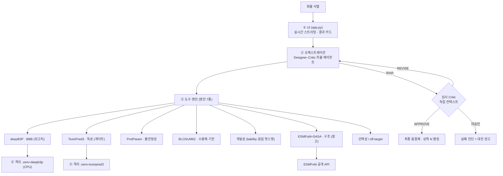
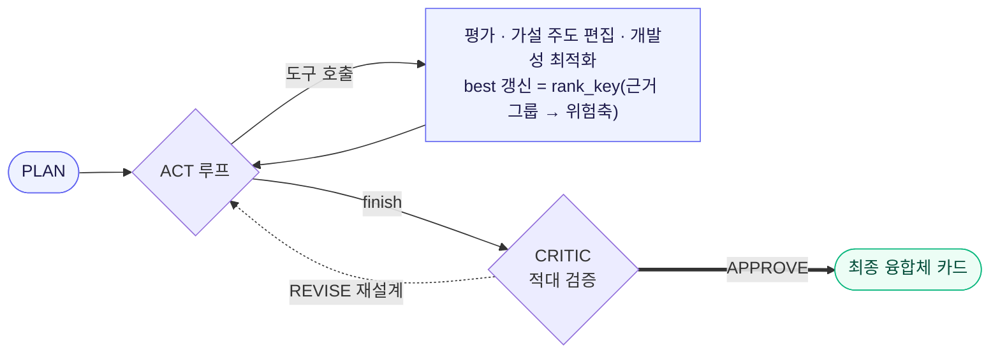

# 🧬 BBB-Optimize AI Agent

혈액뇌장벽(BBB)을 넘겨야 하는 **화물(cargo)**에 검증된 **셔틀·링커**를 붙여 뇌 전달 융합체
(`화물 + 링커 + 셔틀`)를 **자율 설계**하는 **Designer–Critic 멀티 에이전트**. 화물 서열을 넣으면
**설계 에이전트가 평가·가설 주도 잔기 편집·개발성 최적화 도구를 스스로 오케스트레이션**하고,
**독립 심사 에이전트가 적대적으로 검증**해 문헌 근거·독성·개발성·off-target·안정성을 저울질한
최종 후보로 수렴한다.

> **핵심 원리 — 규율 있는 범위 설정**
> **이 시스템은 BBB 투과도를 예측하지 않는다.** 문헌으로 검증된 셔틀을 붙이면 뇌 전달이
> 올라간다는 것은 **문헌에서 빌려오는 전제**이고(차용증: `core/evidence.py`), 이 시스템이 하는
> 일은 그 융합체를 **약으로 만들 수 있게 다듬는 것**이다. 우리 BBB 점수로는 셔틀도 링커도 줄
> 세울 수 없음이 실측으로 확인됐다 — **M6**(셔틀 간, 유의 0/9) · **M8**(링커 간, 라이브러리
> 링커가 같은 길이 **무작위** 링커를 이긴 비율 **0/108**).
> 그래서 순위는 **문헌 근거 그룹 → 위험 축 Pareto** 사전식이고, BBB 는 **보고치**다.
> "모든 지표 최적화"가 아니라 **"무엇을 최적화하고 무엇을 하지 않을지 아는 것"**이 차별점.
> (상세: [docs/experiments.md](docs/experiments.md) §14·§17·§19·§20)

> **동기** — 항체(약 150 kDa)는 BBB에 막혀 투여량의 **0.1–0.2%만 뇌에 도달**한다. 셔틀이 수용체매개
> 수송(RMT)을 편승(hitchhike)해 화물을 넘긴다. 산업 선례: Roche *Brain Shuttle* · Denali *Transport
> Vehicle* · **임상 3상 진입한 로슈 *Trontinemab***(TfR·monovalent).

---

## ✨ 핵심 기능

- **자율 tool-use 에이전트** — `PLAN`(전략 선언) → `ACT`(도구 자율 호출) → `finish`(자기 종료) →
  `CRITIC`(독립 심사) → `REVISE`(재설계). 고정 파이프라인이 아니라 **중간 결과를 보고 다음 도구를
  스스로 결정**한다(off-target이 문제면 잔기 편집, 개발성이 약하면 개발성 최적화, 접합부에
  liability가 생겼으면 링커 설계).
- **🧠 가설 주도 설계 [주인공]** — `design_candidate`로 편집할 때 **무작위 변이가 아니라
  관찰→가설→예측→오라클 검증→반성** 루프로 설계한다. 예측이 빗나가면 에이전트가 인정하고
  재가설 → **LLM의 설계 직관을 신뢰 오라클이 실시간 검증·교정**한다(점수 우기기 불가).
  시스템 프롬프트가 `finish` 전 최소 1회를 요구한다(프롬프트 지시이고 하드 게이트는 아니다).
- **🎯 지표 게이밍(reward-hacking) 회피 [신뢰 가드레일]** — **해킹 가능한 축을 순위에서 제거**하는
  방식으로 막는다. 감점 계수로 달래는 게 아니라, **대응 널**(같은 크기의 무작위 편집과 비교)을
  통과하지 못한 축을 내린다. 그래서 BBB 가 순위에서 빠졌고(M6·M8), 남은 양(陽)의 신호는
  **문헌 근거 등급**(= 서열 편집으로 올릴 수 없는 양) 하나다. 위험 축에도 같은 검사를 돌려
  응집의 길이 아티팩트를 찾아 **모듈 핫스팟**으로 교정했다(M10). 거기에 **독립 심사**의 적대적 반박.
- **📒 설계 이력 원장(ledger)** — 같은 화물을 다시 돌리면 지난 세션이 **실측한** 상위 후보·실패를
  다음 세션의 **바닥**으로 깔아 세션 간 래칫을 만든다(`core/ledger.py`). 목적함수가 바뀌면 옛 원장은
  **읽을 때 폐기**한다(잘못된 바닥은 없는 바닥보다 나쁘다). ⚠️ **벤치마크는 끈다** — 켜면
  콜드 스타트와 비교 불가다.
- **🔬 전달 축 분해 (delivery decomposition)** — deepB3P 점수를 단일 오라클로 쓰지 않고 **셔틀 내재
  투과 × 융합 보존 × 메커니즘(RMT/CPP) 타당도 + avidity**로 분해해 "펩타이드 투과 점수 ↔ 항체 전달"의
  개념 혼동 없이 정직하게 해석.
- **🛠 잔기 편집 = 개발성 스크러빙** — 잔기 수준 편집은 **BBB 개선(오라클 약함)이 아니라
  개발성 liability 스크러빙**으로 재조준(`core/developability_opt.py`). **기존 오라클**(규칙 기반
  developability·AGGRESCAN·rmt_sim — 새 모델 없음, 게임 불가)로, **검증 기능을 보존(rmt_sim≥floor)**
  하며 liability를 제거. **다목적(Pareto) 동시 최적화**(`pareso_scrub`)까지.
- **🔗 링커도 자유 설계** — 링커 생성을 열어두되(표준 20 아미노산·최대 17aa), **링커가 실제로
  움직이는 축만** 노리게 한다. 실측상 off-target·응집은 링커에 거의 반응하지 않고, 링커만
  고칠 수 있는 것은 **접합부를 걸쳐 생긴 liability**다 → `design_candidate` 응답에
  **결정론적 접합부 검사**를 붙인다.
- **✅ 정직한 미승인** — 전 후보 실패 시 결과를 위장하지 않고 **실패 진단 + 시스템 내 대안 권고**.

---

## 🎯 순위 규칙 — 사전식(lexicographic)

이 시스템의 심장이다. **하나의 점수로 합산하지 않는다.**

```
① 문헌 근거 그룹  (유일한 양(陽)의 신호 — 서열 편집으로 올릴 수 없다)
      근거 있음(A·B)  >  주의(C)  >  근거 없음(D)
          ↓ 같은 그룹 안에서만
② 위험 축 4개의 Pareto 지배 관계  (전부 '나쁘지 않음'을 재는 스크린)
      liability 개수 · 불안정성(이진, 임계 40) · off-target · 응집 핫스팟(설계 모듈)
          ↓
③ BBB·수용체 유사도·전달 축 분해 = 보고치 (순위에 쓰지 않는다)
```

- **왜 합산하지 않나**: 위험 축은 전부 "나쁘지 않음"을 재므로, 양의 신호 없이 합산하면
  **불활성 서열이 모든 축에서 이긴다**. 실측: poly-Glu 가 off 0.00 · 선택성 1.00 · 응집 0.12 ·
  liability 0 으로 **등급 B**(기본 A, 간접성 −1) Angiopep-2(0.09 / 0.91 / 0.44 / 2)를 전부 앞선다.
- **왜 축 사이에 가중치가 없나**: liability 가 off-target 보다 중요하다는 근거가 없다. 그래서
  판정은 **지배 관계**(`dominates`)로 하고, 결정론적 정렬이 필요한 자리(러닝 베스트·대체 제시)에만
  표시 관례인 `rank_key`를 쓴다.
- ⚠️ **"비지배"는 "더 좋다"가 아니다** — Pareto 에서 비지배는 *아무도 모든 축에서 나를 이기지
  못한다*는 뜻이고 *내가 누구보다 낫다*는 뜻이 아니다. 설계체를 보고할 때는 **개선된 축과
  악화된 축을 같은 문장에** 적는다(§22-3).

**하드 게이트는 둘뿐** — ① 독성(ToxinPred3 임계 0.38) ② **문헌 근거 등급 보유**(상속 포함).
나머지 축은 탈락 사유가 아니라 "도달 가능 집합 대비 지배당하는가"로만 본다. 절대 기준과
비교하면 승인 가능 영역이 비어버린다(실측: 심사 기준 AND → 당시 라이브러리 130조합 중 0개).

**심사 게이트 체인**(2026-11-10 전면 교체, 앞선 것이 먼저 발동):

```
독성 → 근거 미등재 → 등급 D → CPP 비교군 → 근거 하향 → 지배 → 래칫
```

⚰️ **폐지된 게이트**: BBB 하한(`MIN_BBB_SIGNAL` — 실은 양이온성 필터였다) · 순서 특이성 ·
접합부 길이 z · 전선 이탈(유효점수) · 래칫 여유폭 · 유효점수 λ(`OFF_TARGET_PENALTY`).
λ 는 **옛 실험 재현용으로만** 코드에 남아 있고 순위 경로에서는 호출되지 않는다.

---

## 🎬 시연 (Demo)

```bash
streamlit run app.py
```

화물 서열 입력 → **`자율 설계 에이전트 실행`** → 한 세션(수십 초~수 분)이 **실시간 스트리밍**된다:

1. **화물 입력** — 펩타이드~항체(항상 화물, 단일 경로).
2. **PLAN 카드** — 도구 쓰기 전 전략 선언("근거 있는 탐색").
3. **ACT 스트리밍** — 평가·가설 주도 편집·개발성 최적화 도구 호출이 이벤트 카드로 차례로 등장.
4. **[하이라이트] 지표 게이밍 간파** — 고BBB CPP off-target 후보 → 심사가 **REVISE** → 재설계 → APPROVE.
5. **전달 축 분해 표시** — 후보별 셔틀 내재·융합 보존·메커니즘·avidity 병기("이 숫자는 RMT라 참고치").
6. **최종 카드** — 근거 등급·위험 축·보고치 + 순전하 + 전체 서열. 미승인 시 **실패 진단 + 대안 권고**까지 정직 표기.

### 실행 화면

실제 세션 캡처 — **항체 VH 도메인(118aa)** 을 화물로 넣고 에이전트가 자율 오케스트레이션으로 설계하는 전 과정.

**① 입력** — 화물 서열 입력 (로컬 deepB3P·ToxinPred3 + Gemini 브레인 연동)


**② 계획 (PLAN)** — 에이전트가 목표·제약(**문헌 근거 등급 우선** · RMT 우선 · liability·off-target·응집 최소화)을 스스로 세우고 도구 사용 순서를 설계


**③ 후보 평가 (도구 호출)** — 링커 × 셔틀(Angiopep-2·ApoE·Leptin30…) 조합을 실측 엔진으로 스크리닝해 표로 반환


**④ 구조 검증** — ESMFold로 셔틀이 화물에 가려지지 않고 표면에 노출됐는지 확인. ⚠️ 이것은
**에이전트 도구가 아니다** — 애블레이션에서 기여가 없어 도구에서 빼고, 최종 후보 1건에만
best-effort로 접어 **참고 근거**로 보여준다.


**⑤ 결과 — 최적화 궤적 + 상위 후보** — 라운드별 궤적과 포디움. 랭킹은 **근거 그룹 → 위험 축** 사전식이라 raw BBB가 높아도 비교군 CPP·근거 없는 셔틀은 아예 올라오지 않는다


**⑥ 포디움 상세** — 각 후보에 **전달 축 분해**(셔틀 내재 × 융합 보존 × 메커니즘)·**선택성/off-target**·개발성이 병기됨. 선택된 후보는 **RMT형(T7)** 셔틀


---

## 🧱 아키텍처 & 설계도

### 4계층 구조 (UI · 오케스트레이션 · 도구·엔진 · 격리 실행)



### 에이전트 제어 흐름 (`run()`)



**라이브러리**: **링커 13 × 셔틀 12 = 156 조합**. 괄호는 **문헌 전달 근거 등급**
(M7, `core/evidence.py` — 5개 감사 항목에서 **도출**)이고, **순위에는 거친 3단계만** 쓴다.

| 순위 그룹 | RMT 셔틀(후보군) | CPP(비교군) |
|---|---|---|
| **근거 있음** (A·B) | **Angiopep-2 (B** — 기본 A, 간접성 **−1**) · **ApoE(159-167)₂ (B** — 간접성 **0**, 유일한 유전자 융합 근거) | — |
| **주의** (C) | B6 (C) · RVG29 (C) · CDX (C) · THR (C) | TAT (C) · Penetratin (C) |
| **근거 없음** (D) | **Tet1 (D** — BBB 통과 단독 근거 없음) | — |

- 🔴 **등급은 두 단계로 결정된다 — ① 근거의 단단함 ② 간접성 하향**(GRADE indirectness).
  ②는 **근거의 전달 포맷이 우리 구성체와 다르면 등급을 내린다.** 우리가 만드는 것은
  **단일 폴리펩타이드 유전자 융합체**(셔틀 1벌)인데, 라이브러리 근거의 포맷을 전수 확인하면
  **유전자 융합 근거를 가진 셔틀은 ApoE 하나**다. 등급 A 를 만들던 Angiopep-2 의 `clinical` 은
  **소분자 접합체**(ANG1005 = 파클리탁셀)에서 왔고, T7·B6·RVG29·CDX·THR 의 근거는 전부
  **다가 나노캐리어**(나노입자·LNP·리포솜·AAV)다 — 표면 다가 제시의 avidity 에 의존하므로
  셔틀 1벌 융합으로 **그대로 이전되지 않는다**. 그래서 **−2단계**(다가 나노캐리어·BBB 우회) /
  **−1단계**(공유 접합체·펩타이드 단독) / **0**(유전자 융합)으로 하향한다. **현재 등급 A 는
  없다.** 하향은 **C 가 바닥**이다(D 는 확실성 단계가 아니라 범위 실패라 섞지 않는다).
  표: `python3 -m core.evidence`
- **등급 D·미등재는 CPP와 같은 취급**이다 — 라이브러리·전선에는 비교 근거로 남기고
  **최종 후보로는 올리지 않는다**(`is_candidate`).
- ⚠️ **C 등급의 의미가 각각 다르다**: THR·CDX·Penetratin 은 문헌에서 입증된 형태가
  **retro-enantio·D형·분지형**이고 라이브러리는 **선형 L형**(`form_match` 아니오).
  B6·RVG29·TAT 은 **정량값·기전을 확인하지 못했다**. ApoE(159-167)₂는 문헌에
  **같은 이름의 다른 분자**가 있다(§15-5).
- ⚠️ **SynB1 이 등급 B 인 것은 모순이 아니다** — 등급은 '근거의 단단함'이고 '선택해도 된다'가
  아니다. CPP 의 최종 후보 자격은 **기전 분리**가 따로 막는다(§19-2).

> **CPP를 왜 비교군으로 두나**: 금지가 아니라 **우선순위**다(게이트 통과 RMT가 있을 때만 반려).
> 근거는 ⑴ deepB3P의 양이온 편향 방어와 ⑵ **적응증** — 임상 3상까지 간 nerinetide(TAT 계열)는
> **급성 뇌졸중 단회 투여**이고, 본 과제 화물은 **만성 반복 투여**라 비선택 흡수가 용량 제한
> 독성이 된다. 자세한 반론 대응은 기획서 §2.7.

### 링커의 자리 — 무엇을 움직이고 무엇을 못 움직이나

링커 생성은 열려 있다(표준 20 아미노산·**최대 17aa** = 라이브러리 최장과 동일). 상한의 근거는
BBB가 아니라 **독성 하드 게이트의 길이 희석**이다 — 링커를 늘리면 구성체 독성이 단조 감소해
(`GGS` 0.27 → `(GGGGS)3` 0.20) 독성 셔틀이 게이트를 우회할 수 있다.

| 축 | 링커 민감도 (실측, 라이브러리 13종) | 길이 해킹 |
|---|---|---|
| off-target | **완전 불변** — T7 13/13 모두 0.140 · Angiopep-2 13/13 모두 0.090 | 불가 |
| 응집 핫스팟 | 거의 불변 (0.59~0.60) | 국소 최대라 면역 |
| liability | **움직인다** — `WGGGGS`가 T7에서 1→2 (W 산화) | 개수라서 면역 |
| 불안정성 | 가장 크게 (19.6~58.4) | **이진 축(40)이 방어** |

🔴 불안정성의 길이 의존은 **조성에 따라 방향이 반대**다 — 유연 GS는 길수록 나빠지고
(`GGS` 30.0 → `(GGGGS)3` 52.7), 강직 EAAAK는 길수록 좋아진다(`EAAAK` 22.9 → `A(EAAAK)3A` 19.6).
즉 강직 반복으로 II를 깎는 경로가 실재하는데, **이진화가 그 해킹을 무력화**하고 있다
(그래서 연속화하지 않았다).

🟢 **링커만 고칠 수 있는 축 = 접합부 liability.** liability는 모티프 **개수의 합**이라
화물·셔틀 **내부** 모티프는 링커로 못 없앤다. 링커가 고칠 수 있는 건 **접합부를 걸쳐 생긴**
모티프뿐이다. 실측: 화물 `...GLN`(끝 N) + 셔틀 B6 `G...` 는 직접융합에서 `NG`가 생겨 liab 3 →
`EAAAK`·`A`·`AAAAA`로 **2로 내려가지만 `GGS`는 3 그대로**다(G로 시작해 N과 다시 `NG`).
대조군(끝이 M인 화물)은 링커 5종 전부 **불변** = 효과가 접합부 모티프에 특이적이다.
⚠️ 라이브러리 13종 중 **5종이 G로 시작** → **N/Q로 끝나는 화물에서는 표준 GS 링커가 전부
모티프를 남긴다.** 그래서 `design_candidate` 응답에 **결정론적 접합부 검사**를 붙인다
(모티프 존재가 **화물마다 다르므로** 프롬프트 규칙으로는 부족하다).

---

## 📊 성능 평가 (Evaluation)

평가 세트·지표 설계 원리·실측은 **[EVALUATION.md](EVALUATION.md)** 참고. 재현:

```bash
python3 benchmark.py             # M1 판별력 · M2 도달 가능 집합 · M3 독성 가드레일 (로컬, LLM 0회)
python3 benchmark_agent.py       # M4 에이전트 효율 · M5 심사 효과 (LLM 필요)
python3 benchmark_agent.py --sessions 3 --skip-m5        # M4 분산 추정 (콜드 3세션)
python3 benchmark_agent.py --sessions 2 --seed-ledger \
        --cumulative 1 --skip-m5  # 누적 모드(원장 ON) — 콜드와 **따로** 보고
python3 -m core.evidence              # M7 문헌 근거 등급 + 감사 루브릭 표 (로컬, LLM 0회)
python3 scripts/directional_pairs.py  # M6 방향성 쌍 — 외부 대조 (로컬, LLM 0회)
python3 scripts/bench_selectivity.py  # 선택성 축 AUC (로컬, LLM 0회)
```

⚠️ **M8·M9·M10 은 재현 스크립트가 동봉돼 있지 않다** — 애드혹 측정이고 방법·수치는
`docs/experiments.md` §17·§18·§20 에 기록돼 있다. 스크립트화는 미완 과제다.

벤치마크는 **설계 이력 원장을 끈 상태**(`use_ledger=False`)로 돌아간다 — 원장을 켜면 이전 세션의
탐색을 물려받아 콜드 스타트와 비교가 성립하지 않는다. 원장 효과를 보려면 `--cumulative` 로
**별도 실험**으로 재고 콜드와 나눠 보고한다(`--seed-ledger` 는 콜드 세션 결과를 원장에
**기록만** 한다 — 읽지 않으므로 콜드 측정은 오염되지 않는다).

| 지표 | 실측 |
|---|---|
| **M1 판별력** | AUC **0.807**(양성 vs 무작위) · 단 **스크램블**(조성 동일) 대비는 **0.618** → 점수의 상당 부분이 **조성**에서 온다 |
| **M2 도달 가능 집합** | 156조합 → 비독성 132 → **후보군 89**(CPP 30·등급 D 13 제외) · 근거 그룹 **근거 있음 26 / 주의 63** · 최상위 그룹 Pareto 전선 **5개**(Angiopep-2 4 · ApoE 1) · 무작위 기저선(초기하분포 정확계산): 12회 평가로 그 전선에 닿을 확률 **후보군(N=89) 기준 52.4% / 전수(N=132) 기준 38.4%** |
| **M3 가드레일** | 독소 **2/2 검출**(멜리틴·마스토파란), 오탈락 0 |
| **M4 에이전트 효율**(라이브 **콜드 3세션**) | 3문항 **3/3 재현** — ① 최상위 근거 그룹 ② 전선에 비지배 ③ 라이브러리 밖(설계체). 평가 **7~10회**. 등급 **A 상속**을 유지한 채 부모 전선 멤버 대비 **불안정성 38.9→19.5~25.8 · 응집 0.75→0.52**. 🔴 단 **지배하는 전선 멤버는 0개** — off 0.09→0.20 악화와의 **교환**이다. 서열은 3세션 3종 = 변동 |
| **M5 심사 효과**(라이브) | 불량 **7/7 REVISE**(겨냥한 게이트까지 일치: 독성·근거 미등재·지배·등급 D·CPP·근거 하향·래칫) · 양호(`A(EAAAK)3A+Angiopep-2`) **APPROVE_WITH_LIMITS**, 오탈락 0. 🔴 유료 실행 전 로컬 점검에서 **프로브 3개가 어긋나 있어 교정**했고, 게이트 식별 **마커 문구 겹침**도 고쳤다(§21-4·§21-5). 🔴 간접성 축 도입 후 **프로브 2개를 다시 재기초**했다(T7 이 등급 C 가 되어 '양호'가 근거 하향에 오탈락, 과편집 프로브는 전선 변화로 지배 관계가 끊김) — **프로브는 등급 체계와 전선에 의존한다** |
| **M6 방향성 쌍**(외부 대조) | 융합 수준 BBB에 **서열 순서 신호 없음**(경험 p 중위 **0.392**, 유의 **0/9**) · 문헌 음성 대조군 **Angiopep-7이 Angiopep-2보다 높게** 나옴(0.978 vs 0.867) |
| **M7 문헌 근거 등급**(외부 대조) | 라이브러리 12종에 등급 부여 + **5개 감사 항목에서 도출**(선언·도출 불일치 시 임포트 실패). 루브릭 적용으로 제 등급 **3개가 교정**됨(B6 B→C · RVG29 B→C · SynB1 C→B) |
| **M8 링커 대응 널** | 라이브러리 링커가 같은 길이 **무작위** 링커를 이긴 비율 **0/108 (0.0%)**(우연 ~5%) · 경험 p 중위 ~0.86 = **거꾸로** · 링커 길이↔BBB 순위상관 평균 **−0.495**(= '링커 선택'이 '짧게 하기'였다) |
| **M9 근거 등급 상속** | 양성(개발성 변이체 55개) 부모 유사도 최소 **0.830** vs 음성 최대(스크램블 0.529·homopoly 0.429·무작위 0.136·타셔틀 **0.088**) → 간극 [0.529, 0.830] → 임계값 **0.70** · 교차 오상속 **0/55** |
| **M10 새 축 대응 널** | 위험 축은 대응 널을 **통과** — 라이브러리 링커가 같은 길이 무작위를 이긴 비율 **41/96 (42.7%)**(BBB 는 0/108). 단 응집 전역평균에 길이 아티팩트(ρ **−0.697**)가 있어 **모듈 핫스팟**으로 교정(→ **+0.263**) |
| **누적 모드**(원장 ON, 참고치) | 바닥 `GGGGS+HAIYPRH`(근거 B) → 최종 근거 **A** · 평가 **6회**(콜드 7~10)로 **근거 그룹 상향**. 🔴 **n=1 이고 위험 축은 콜드보다 나쁘다**(II 34.4 vs 19.5~20.1) → **"원장이 효율을 올린다"는 주장 불가.** 콜드와 **비교 불가**라 별도 보고 |

> ⚠️ **이 도구가 하는 일을 정직하게 쓰면** — **"문헌으로 검증된 BBB 셔틀을 화물에 붙인
> 융합체를, 문헌 근거의 단단함 순으로 고르고 그 안에서 개발성·안전성 기준으로 다듬는다"**이고,
> **"BBB 투과율을 예측한다"가 아니다.** 근거: M6(§14)·**M8**(§17)이 각각 셔틀 간·링커 간
> 순위를 반증했다. BBB 는 **보고치**로만 제시한다.
>
> 그렇다고 BBB 근거가 사라진 것은 아니다 — **출처가 우리 점수가 아니라 문헌**일 뿐이다.
> 그 차용증이 `core/evidence.py` — 셔틀별 **근거 등급·인용·측정 맥락**의 단일 출처이고,
> 등급은 **5개 감사 항목**(정량·기전·임상·형태일치·BBB단독)에서 **도출**된다. 글자를 손으로
> 바꾸면 임포트가 실패한다. 표: `python3 -m core.evidence`
>
> ⚠️ **순위에는 거친 3단계만 쓴다**(근거 있음=A·B / 주의=C / 근거 없음=D). 후보군 9종 중
> A가 1종뿐이라 **가장 무른 판단(A/B 경계)이 결과를 단독 결정**하기 때문이다. 등급이 재는
> 것은 **"근거가 얼마나 단단한가"**이고 "전달이 얼마나 잘 되나"가 아니다.
>
> ⚠️ 문헌 근거 등급은 **1인·1세션 큐레이션**이고 외부 검증을 받지 않았다. 한계는
> [EVALUATION.md](EVALUATION.md) 「한계」 절에 명시.
>
> ⚠️ **벤치마크는 전부 화물 하나(`GSNKGAIIGLM`)로 측정됐다.** 이 화물은 M으로 끝나 접합부
> 모티프가 생기지 않으므로 **접합부 liability 축은 구조적으로 검출될 수 없었다**(§23-6).
> 일반화하면: **지표가 입력에 의존하면 입력 하나로는 지표의 유효성을 판정할 수 없다.**

**축·방법론 검증** (상세: [docs/experiments.md](docs/experiments.md)):

| 검증 | 결과 |
|---|---|
| **선택성 축** (RMT vs CPP) | AUC **1.000** — 반면 deepB3P 단독 **0.468**(<0.5, 양이온 CPP를 더 높게 랭킹 = **보상해킹 실증**). 재현: `scripts/bench_selectivity.py`. ⚠️ 단 이것은 **라벨 복원**이고 순위 축으로서의 유효성 증명이 아니다(라벨이 근거 등급과 같아 거의 순환) |
| **선택성 축 제거 애블레이션** | 위험 축을 4축 → 3축(off 제거)으로 줄이면 `front_top` **5개 → 1개** 붕괴, **Angiopep-2 가 전선에서 소멸**(ApoE 가 liab 1<3·응집 0.66<0.75 로 지배) → 이 축은 **대표 셔틀을 선택 가능하게 유지하는 유일한 축**이고, 「비지배 ≠ 우위」의 실례다. 🔴 **단독 대응 널은 아직 미측정** |
| **개발성 — 응집 신호** (아밀로이드 10 vs 가용성 10) | AUC **0.96**, 가중치 섭동에 둔감(Spearman 최소 0.946·평균 0.992). ⚠️ 재현 스크립트 미동봉 — 방법·수치는 `docs/experiments.md` §2 |
| **Angiopep-2 vs Angiopep-7** | deepB3P가 **뇌 전달 ~9.5배 낮은**(모세혈관에 갇히는) 변이체를 **더 높게**(0.978 vs 0.867) = BBB 편집 비신뢰 |
| **개발성 잔기 편집** | 제약 편집 **기능 보존 7/7**(liability 평균 0.86개↓) vs 무제약 **기능 파괴 7/7** — 핵심은 "기능 보존하며 스크럽" |
| **다목적(Pareto) 개발성** | liability·응집·불안정성 **동시 최적화** — Pareto 전선(RVG29 17·Angiopep-2 12개)이 시드 지배, 진짜 트레이드오프 |
| **공진화 vs 분리** | 무승부 · 구조 노출도 가산적(상호작용/주효과 비 0.18–0.19) → **분리 최적화 채택**. ⚠️ 구현은 **`with-coevolution` 브랜치에만** 있고 본선 코드에서 제거됐다 |

> ⚠️ deepB3P는 짧은 펩타이드 학습 모델 — 긴 융합체는 조합 간 **상대 비교**로 해석하며 절대 투과율이
> 아니다. 구조 노출도·선택성·개발성은 **휴리스틱 프록시**. 실제 적용 전 In Vitro/In Vivo 검증 필요(Tier 로드맵).
> 융합 방향은 **C-말단 셔틀로 고정**(채점창 정렬 + 문헌 정합: Brain Shuttle C-말단 융합·Angiopep N-말단 화물) —
> N/C 방향 비교와 수용체 결합 기하(에피토프)는 **향후 과제**(구조 도킹 Tier 3).

---

## 🔬 예측 엔진 & 도구

| 축/기능 | 엔진 | 방식 |
|---|---|---|
| BBB 투과 (보고치) | [deepB3P](https://github.com/GreatChenLab/deepB3P) | 펩타이드 서열 딥러닝 5-fold (로컬 CPU) |
| 독성 (하드 게이트) | [ToxinPred3](https://github.com/raghavagps/toxinpred3) | AAC+DPC → Extra-Trees (로컬, GPL-3.0) |
| 구조 (참고 근거) | [ESMFold](https://esmatlas.com/) | 공개 API 폴딩 + Shrake-Rupley SASA |
| 수용체·선택성·개발성 | Biopython + 규칙 엔진 | BLOSUM62 정렬 · 서열 규칙 · AGGRESCAN a3v (로컬) |
| 브레인(추론) | **Google Gemini**(기본) | 자율 최적화 에이전트 (Claude는 `with-claude` 브랜치) |

**에이전트 도구는 4개다**:

| 도구 | 역할 |
|---|---|
| `evaluate_candidates` | 배치 채점 — **라이브러리 조합 전용**(한 잔기라도 편집한 서열은 채점 거부) |
| `design_candidate` | 가설 주도 자유 설계 — **셔틀·링커 둘 다**. 가설·예측 필드 필수, 응답에 근거 상속 결과 + **접합부 liability 검사**를 즉시 반환. 라이브러리 밖 **전용 통로**다(평가 도구가 라이브러리만 받으므로) |
| `optimize_developability` | 셔틀 개발성 다목적 Pareto 최적화 (기능 보존 `rmt_sim ≥ floor`) |
| `finish` | 자기 종료 — 최종 후보 제출 |

구조(ESMFold)는 **도구에서 제거**하고 최종 후보 1건의 참고 근거로만 남겼다 — 자기 축(셔틀 노출도)에서조차
기여가 없다는 애블레이션 결과(→ [docs/experiments.md](docs/experiments.md) §11)를 따랐다.
같은 애블레이션에서 **`evaluate_candidates`가 임의 서열까지 채점해 설계 통로로 쓰이고 있었다**는 것도
드러나, 평가(라이브러리 선택)와 설계(라이브러리 밖)를 **게이트로 분리**했다. 또 16세션 중 7세션이
**이미 본 더 좋은 후보를 버리고 제출**(최대 −0.395)해, 심사자에 **래칫 게이트**를 추가했다.

**자원 경량**: deepB3P·독성은 **CPU 완결**, 구조는 ESMFold **공개 API** → 프런티어 GPU 불필요.

---

## ⚙️ 설치

### 1. 앱 본체
```bash
pip install -r requirements.txt        # streamlit
pip install biopython requests        # 서열·구조 분석
```

### 2. 로컬 예측 엔진 (별도 클론 + 모델 + venv)
제3자 코드·모델 가중치는 이 repo에 포함하지 않는다(라이선스/용량). 아래로 재현:

```bash
mkdir -p vendor && cd vendor

# --- deepB3P (BBB 스코어러) ---
git clone https://github.com/GreatChenLab/deepB3P.git
python3 -m venv .venv-deepb3p
.venv-deepb3p/bin/pip install -r ../requirements-deepb3p.txt
cp ../scripts/deepb3p/_run_predict.py deepB3P/

# --- ToxinPred3 (독성) ---
git clone https://github.com/raghavagps/toxinpred3.git
python3 -m venv .venv-toxinpred3
.venv-toxinpred3/bin/pip install -r ../requirements-toxinpred3.txt
(cd toxinpred3/model && unzip -o toxinpred3.0_model.pkl.zip)
```

`core/config.py`가 `vendor/` 경로를 자동 감지해 로컬 엔진을 켠다.

### 3. LLM 에이전트 (선택)
```bash
pip install google-genai               # ⚠️ 이게 없으면 자율 에이전트가 켜지지 않는다
cp .env.example .env                   # .env 에 GEMINI_API_KEY 입력
```
키는 [Google AI Studio](https://aistudio.google.com/apikey)에서 무료 발급(무료 티어 있음).
모델은 `.env`의 `GEMINI_MODEL`로 바꿀 수 있다(기본 `gemini-3-flash-preview`; pro는 무료 티어 쿼터가
빡빡해 429가 잦다). 키가 없으면 데모 모드로 예시 결과 화면을 미리볼 수 있다(값은 "예시"로 명시).

> 설치 요약: `requirements.txt`(Streamlit) → `biopython requests` → `vendor/`에 deepB3P·ToxinPred3
> 클론+venv → `pip install google-genai` → `.env`에 `GEMINI_API_KEY`.
> Python **3.9+**(개발·검증 환경은 3.9.6).

## ▶️ 실행

### 로컬 (기본)
```bash
streamlit run app.py
```
브라우저에서 `http://localhost:8501` 자동 오픈. 본인 PC에서만 접속된다.

### 외부 서버 (다른 사람도 접속)
Streamlit은 기본적으로 로컬에만 바인딩된다. **서버의 모든 인터페이스(0.0.0.0)에 바인딩**하고 헤드리스로 띄우면
네트워크 밖에서도 접속된다:

```bash
streamlit run app.py \
  --server.address 0.0.0.0 \
  --server.port 8501 \
  --server.headless true
```

- 접속: `http://<서버_공인IP_또는_도메인>:8501`
- **방화벽/보안그룹에서 8501 포트 인바운드 허용** 필요(AWS Security Group, GCP 방화벽, `ufw allow 8501` 등).
- 세션이 끊겨도 돌게 하려면 `nohup ... &`, `tmux`/`screen`, 또는 `systemd` 서비스로 띄운다.

> ⚠️ **서버에도 로컬 엔진이 똑같이 설치돼야 한다.** deepB3P·ToxinPred3는 `vendor/`의 격리 venv를
> 서브프로세스로 호출하므로(§설치 2단계), 서버에 `vendor/`가 없으면 BBB/독성 실측이 꺼지고 폴백으로 동작한다.
> `.env`의 `GEMINI_API_KEY`도 서버에 있어야 자율 에이전트가 켜진다.

#### 리버스 프록시(nginx/도메인·HTTPS) 뒤에 둘 때
공개 도메인·SSL로 서비스하려면 nginx가 WebSocket을 프록시하도록 하고(Streamlit은 WS 사용), 하위 경로로
서빙하면 `--server.baseUrlPath`를 맞춘다:

```nginx
# /etc/nginx/... — 예시 (example.com → 127.0.0.1:8501)
location / {
    proxy_pass http://127.0.0.1:8501;
    proxy_http_version 1.1;
    proxy_set_header Upgrade $http_upgrade;      # WebSocket 업그레이드
    proxy_set_header Connection "upgrade";
    proxy_set_header Host $host;
}
```
프록시 뒤에서는 Streamlit을 `--server.address 127.0.0.1`(로컬만)로 두고 외부 노출은 nginx(80/443)가 담당한다.

> 🔒 이 앱에는 자체 인증이 없다. 공개 노출 시 리버스 프록시의 **basic-auth**나 접속 IP 제한을 두는 것을 권장.

---

## 📁 구조
```
app.py                      Streamlit UI (얇은 표시·스트리밍 계층 · 데모 모드 포함)
benchmark.py                M1~M3 (로컬 엔진·LLM 0회)
benchmark_agent.py          M4~M5 + 누적 모드 (LLM 필요, --sessions/--cumulative/--seed-ledger)
core/
  config.py                 상수·경로 자동감지, 셔틀·링커 라이브러리, 연결부위 윈도우
  schemas.py                데이터 구조 (Verdict·PredictionResult·ToxicityResult)
  optimizer_agent.py        도구 백엔드(_evaluate · _structure · reachable_front) + 순위 규칙
                            (risk_axes · dominates · rank_key · is_candidate · 링커 검증)
  optimizer_agent_gemini.py 브레인 루프(PLAN→ACT→finish→CRITIC→REVISE) + 게이트 체인
  ledger.py                 설계 이력 원장 — 세션 간 래칫 (⚠️ 벤치마크는 OFF)
  evidence.py               문헌 전달 근거 등급 — 순위의 유일한 양(陽)의 신호 (M7·상속 M9)
  predictors.py             BBB 예측기 (deepB3P local / API / 폴백)
  toxicity.py               독성 예측기 (ToxinPred3 local / placeholder)
  delivery.py               전달 축 분해 (셔틀 내재 × 보존 × 메커니즘 + avidity)
  binding.py                수용체 유사도 (BLOSUM62, RMT/CPP 참조 세트)
  selectivity.py            선택성 / off-target (만성 반복투여 비선택 흡수 위험 + 설계체 양이온 드리프트 감시)
  developability.py         개발성 liability·응집(AGGRESCAN a3v)·용해도·전하 + 접합부 모티프 검출
  developability_opt.py     개발성 liability 스크러빙 + 다목적(Pareto) 최적화 (기능 보존)
  stability.py              ProtParam 불안정성
  structure.py              ESMFold 구조 + 셔틀 노출도 (빠른 실패·캐싱)
  order_specificity.py      스크램블 대응 널 (M6 검증 전용 — 순위 게이트에서는 폐지)
scripts/
  deepb3p/_run_predict.py   deepB3P venv에서 도는 BBB 러너 (설치 시 vendor/deepB3P/ 로 복사)
  directional_pairs.py      M6 방향성 쌍 — 외부 대조
  bench_selectivity.py      선택성 축 AUC
  scramble_delta.py         순서 특이성(스크램블 델타) 측정
  ablation_tools.py         도구 애블레이션 (ablation_axes.py · ablation_report.py)
  prewarm_esmfold.py        발표용 ESMFold 구조 캐시 프리워밍
EVALUATION.md               평가 세트·지표 설계 원리·실측
docs/experiments.md         전 실험 기록 (§1~§24 — 수치의 단일 출처)
assets/theme.css            디자인 시스템 테마
```

⚠️ `scripts/deepb3p/_run_fbgan.py` · `_physchem.py` 는 **폐지된 FBGAN 경로의 사장 코드**로,
어디서도 호출되지 않는다(정리 예정).

## 📜 라이선스 주의
`vendor/`의 ToxinPred3는 **GPL-3.0**, deepB3P는 라이선스 미명시. 재배포·상업적 사용 시 각
저작자·라이선스를 확인할 것. 이 repo에는 포함하지 않는다.
