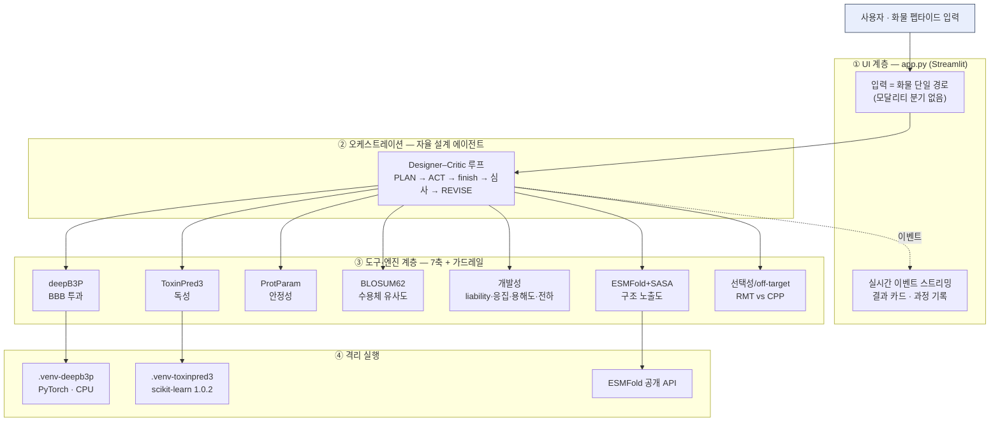
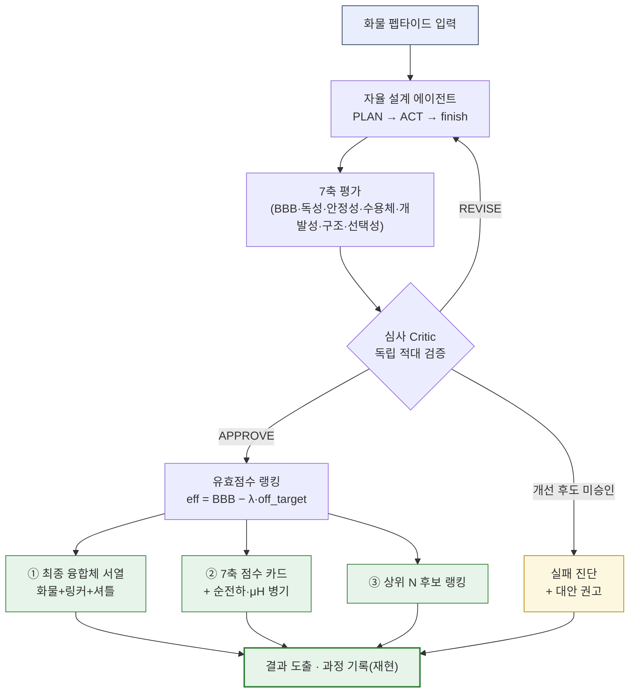
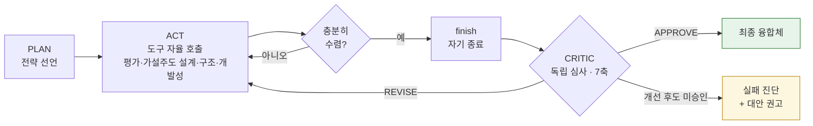
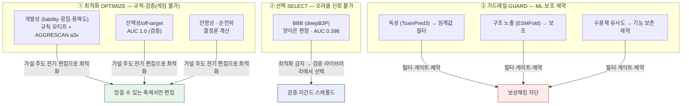
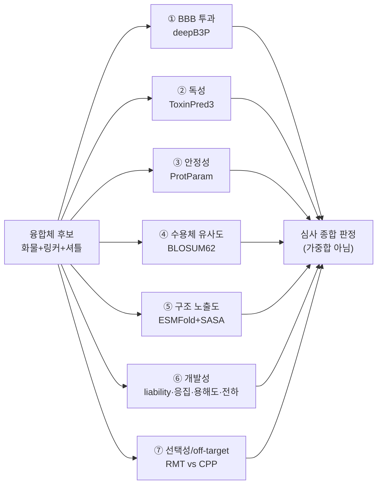
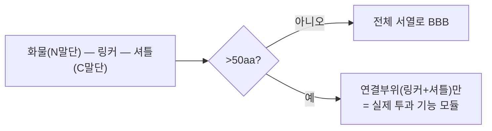
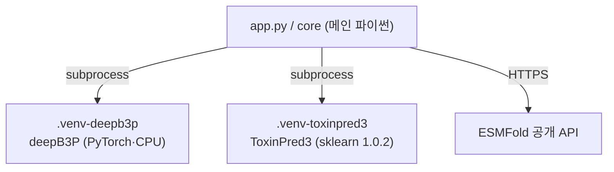

# BBB-Optimize — 시스템 아키텍처 (상세)

> 화물(cargo) 펩타이드를 입력하면 `융합체 = 화물 + 링커 + 셔틀`을 자율 설계·검증하는
> **단일 자율 에이전트(Designer–Critic) in-silico 신약설계 시스템**의 아키텍처 문서.
> 각 다이어그램은 GitHub/논문에서 바로 렌더된다. 코드 위치는 각 절 끝에 표기.
>
> **핵심**: 실행 경로는 **하나**(자율 설계 에이전트)다. "4가지 모드 선택"·FBGAN·공진화는 구 설계로
> 제거됐다. 평가는 **7축**이며(용해도는 개발성에 통합), 잔기 편집은 **가설 주도**로 수행한다.

**읽는 순서**: ①전체 계층 → ②전체 흐름(입력→결과) → ③에이전트 루프 → **④규율 있는 범위 설정(핵심 철학)**
→ **⑤가설 주도 설계** → ⑥평가 7축 → ⑦연결부위 윈도잉·융합 방향 → ⑧격리 실행.

---

## 1. 전체 계층 구조 (4계층)

입력 하나(화물 펩타이드)가 **① UI → ② 자율 에이전트 → ③ 7축 엔진 → ④ 격리 실행**을 거친다.
무거운 예측 모델은 의존성 충돌을 피해 **격리 venv에서 subprocess**로 돈다.

- **의존성 주입**: 설정을 보고 **로컬 실측 > 원격 API > 예시(데모)** 순으로 자동 선택.
- **관심사 분리**: UI는 얇게(app.py), 계산은 `core/*.py`, 데이터 구조는 dataclass(`schemas.py`).

📁 `app.py` · `core/config.py`(경로 자동감지) · `core/predictors.py` · `core/toxicity.py`

---

## 2. 전체 흐름 — 입력에서 결과 도출까지

입력 한 개(화물 펩타이드)가 **에이전트 → 7축 평가 → 심사 → 랭킹 → 산출물**로 수렴한다.
세 갈래 결과: **① 승인된 최종 융합체**, **② 상위 N 랭킹**, **③ 미승인 시 실패 진단 + 대안 권고**.

- **승인**: 심사 APPROVE → **유효점수(eff = BBB − λ·off_target, λ=0.25)**로 랭킹 → 최종 융합체 + 7축 카드 + 상위 N.
- **재설계**: REVISE면 심사 반박을 설계자에 피드백 → 재설계(grace로 최소 1회 보장).
- **미승인**: 개선 후에도 통과 못 하면 **정직하게 "미승인"** 표기 + 실패 진단 + 대안(잔기 편집·링커 교체·다른 셔틀).
- **공통**: 모든 과정을 실시간 스트리밍·기록 → **재현·감사 가능**.

📁 `app.py`(결과 렌더) · `core/optimizer_agent_gemini.py`

---

## 3. 멀티 에이전트 루프 — Designer–Critic (적대적 검증)

고정 파이프라인이 아니라 **관찰→판단→행동을 스스로 반복**한다. 설계자(Designer)가 후보를 만들고,
**독립 컨텍스트**의 심사자(Critic)가 적대적으로 반박한다.

- **계획(PLAN)**: 도구 쓰기 전 전략을 명시 선언 → 근거 있는 탐색.
- **정밀 설계(design_candidate)**: 라이브러리 선택을 넘어 **잔기 수준 편집**을 가설 주도로 직접 제안(§5).
- **자기 종료(finish)**: 스텝 소진이 아니라 "수렴"을 에이전트가 스스로 선언.
- **재설계 여유(grace)**: 심사 REVISE가 마지막 스텝에 나와도 개선 1회를 **별개로 보장**.
- **정직한 미승인**: 통과 못 하면 "심사 미승인"으로 표기(거부 후보를 최종으로 위장 안 함).
- **지표 게이밍 간파**: deepB3P가 양이온 CPP를 고평가하는 편향을 이용한 **"BBB는 높지만 off-target"**
  후보를 심사가 **선택성 축**으로 잡아 뒤집는다(reward-hacking 방지).

📁 `core/optimizer_agent_gemini.py`(설계·심사 루프) · `core/optimizer_agent.py`

---

## 4. 규율 있는 범위 설정 (핵심 철학)

본 시스템의 핵심은 "다 잘하기"가 아니라 **"무엇을 최적화하지 않을지 아는 것"**이다. 축을 **오라클 신뢰도**로
3분류해, **믿을 수 있는 곳만 최적화**하고, 못 믿는 곳은 **검증된 것을 선택**하며, ML 축은 **가드레일**로 둔다.

- **근거**: deepB3P는 양이온 CPP를 과대평가(보상해킹) → BBB 축은 **최적화 대상이 아니라 선택 대상**.
- **잔기 편집의 정당한 집 = 개발성**(규칙 기반 = 거의 "사실"이라 게임 불가). 검증: 기능 보존 7/7.
- **규율의 아키텍처 적용**: "근거 없는 복잡성은 넣지 않는다" — 애블레이션 음성인 공진화를 제거한 것도 같은 원칙.

📁 `core/{selectivity,developability,developability_opt}.py` · `docs/experiments.md`

---

## 5. 가설 주도 설계 (design_candidate)

잔기 편집을 **무작위 변이**가 아니라 **과학적 가설 검증 루프**로 수행한다. LLM이 추론으로 편집을 제안하고,
**신뢰 오라클이 검증**한다 — 예측이 틀리면 솔직히 인정하고 재가설(점수 조작 불가).

- **정직성 내장**: LLM이 "좋아졌다"고 우겨도 **오라클이 반증하면 드러남** → 보상해킹이 설계 단계에서 차단.
- **라이브 예시**: "강성 링커로 보존도↑ 예상 → 오라클 반증(BBB↓) → 인정·재가설 → 더 나은 후보 수렴".
- **de-novo 금지**: 셔틀을 무작위 생성하지 않고 **검증 리간드에서 출발해 보존적으로** 편집.

📁 `core/optimizer_agent_gemini.py`(design_candidate: hypothesis·prediction 필드)

---

## 6. 평가 엔진 — 7축

각 후보는 **7개 독립 축**으로 평가된다. "효능(BBB)"만 보지 않고 안전·안정·선택성·개발성을 함께 저울질.

| 축 | 무엇을 | 원리(요약) | 신뢰도·역할 |
|---|---|---|---|
| ① BBB 투과 | 투과 확률 | 트랜스포머 5-fold 앙상블 | 양이온 편향 → **선택**(최적화 X) |
| ② 독성 | 위험도(>0.38 탈락) | AAC+DPC → Extra-Trees | ML → **가드레일** |
| ③ 안정성 | 분해·응집 경향 | 불안정성 지수(Guruprasad) | 공식 → 최적화 |
| ④ 수용체 유사도 | 수송 메커니즘 근거 | BLOSUM62 전역정렬 | 프록시 → 기능 보존 제약 |
| ⑤ 구조 노출도 | 셔틀 표면 노출? | ESMFold → Shrake-Rupley RSA | 휴리스틱 → 보조 |
| ⑥ 개발성 | 제조·안정 liability | 모티프 + 응집(AGGRESCAN) + 용해도 + pH7.4 순전하 | 규칙 → **최적화(편집의 집)** |
| ⑦ 선택성 | RMT(선택) vs CPP(비특이) | (전하∨소수성)×(1−0.6·RMT유사) | 검증 AUC 1.0 → **가드레일** |

> ※ 용해도·응집은 예전 별도 '용해도 축'이었으나 중복 신호 정리로 **개발성(⑥)에 통합**(8축→7축).

📁 `core/{binding,toxicity,stability,selectivity,developability,structure}.py`

---

## 7. 연결부위 윈도잉 & 융합 방향 (설계 근거)

**문제**: 항체 융합체(수백 aa)는 deepB3P 학습 분포(짧은 펩타이드) 밖 → 전체 서열 점수 신뢰 불가.
**해법**: 50aa 초과 시 BBB는 **연결부위(링커+셔틀)만** 계산(화물 벌크 제외), 독성은 전체 서열.

- **정당성**: 항체 화물은 혼자선 BBB를 못 넘고, 투과를 담당하는 건 **오직 셔틀**이다. 화물 벌크를 넣으면
  조성 편향 노이즈만 섞인다(검증: 화물 포함 시 링커 민감도 소실 → `JUNCTION_FLANK=0`).
- **융합 방향**: construct는 **cargo(N말단) + linker + shuttle(C말단)** 고정 — 채점창(C말단)에 전달 모듈을
  맞추고, 문헌 선례와도 정합(Brain Shuttle C말단 융합 · Angiopep N말단 화물). N/C 비교는 향후 과제.

📁 `core/config.py`(`junction_window`·`bbb_scoring_seq`)

---

## 8. 격리 실행 & 설계 원칙

- **왜 격리**: deepB3P(PyTorch)와 ToxinPred3(**scikit-learn 1.0.2 핀**)는 의존성이 충돌 → 각자 전용 venv에서
  `subprocess`로 호출하고 JSON으로 결과 회수.
- **교체 가능 브레인**: LLM은 독립 계층 → Gemini(기본)/Claude(`with-claude` 브랜치)를 갈아끼워도 도구·엔진·출력 동일.
- **자원 경량**: deepB3P는 CPU, ESMFold는 공개 API → 상시 GPU 불필요. 저분자 도구(RDKit 등)는 펩타이드
  모달리티에 부적합해 의도적으로 배제.

📁 `vendor/*`(격리 venv) · `core/config.py`
